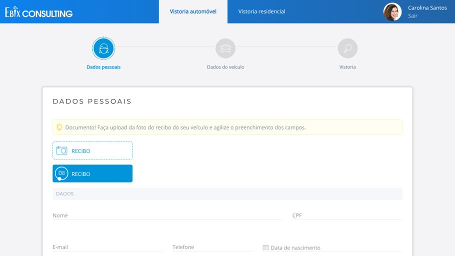
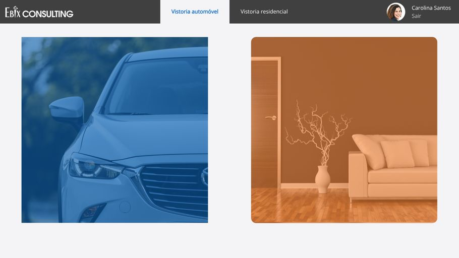
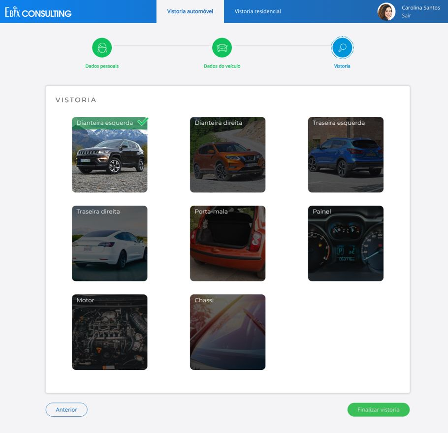
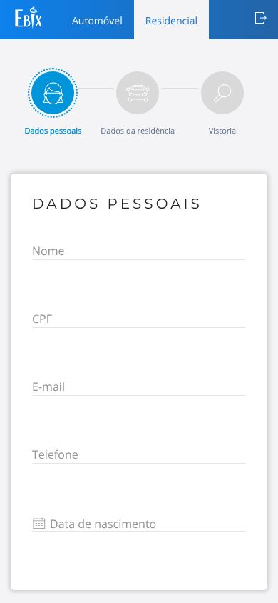

# Protótipo Auto Vistoria

Protótipo navegável de **autovistoria de seguros** para **automóvel** e **residência**.
O segurado entra com o CPF, escolhe o tipo de vistoria e segue um fluxo em etapas:
preenche os próprios dados, informa os dados do bem e envia as fotos pedidas
(dianteira, traseira, painel, motor, chassi, cômodos da casa etc.).

O projeto é **front-end estático**: HTML, CSS e JavaScript, sem back-end. Ele serve para
validar a jornada, a interface e a interação com usuários e stakeholders antes do
desenvolvimento do produto real.



---

## Sumário

- [Fluxo e telas](#fluxo-e-telas)
- [Tecnologias](#tecnologias)
- [Estrutura do projeto](#estrutura-do-projeto)
- [Como rodar localmente](#como-rodar-localmente)
- [Publicação (GitHub Pages)](#publicação-github-pages)
- [Segurança](#segurança)
- [Acessibilidade](#acessibilidade)
- [Limitações conhecidas](#limitações-conhecidas)
- [Próximos passos](#próximos-passos)
- [Histórico de mudanças](#histórico-de-mudanças)
- [Autor](#autor)

---

## Fluxo e telas

```
index.html ──► login.html ──► home.html ─┬─► vistoria-automovel.html
                (CPF)        (escolha)   └─► vistoria-residencial.html
```

| Tela | Arquivo | O que faz |
| --- | --- | --- |
| Login | `login.html` | Pede o CPF, com máscara e validação dos dígitos verificadores. Não há autenticação real. |
| Início | `home.html` | Mostra dois cards, um para cada tipo de vistoria: automóvel e residência. |
| Vistoria automóvel | `vistoria-automovel.html` | Tem 3 etapas: **Dados pessoais** (com upload do recibo), **Dados do veículo** (documentos, informações básicas, equipamentos) e **Vistoria** (8 fotos do veículo). |
| Vistoria residencial | `vistoria-residencial.html` | Tem 3 etapas: **Dados pessoais**, **Dados da residência** (endereço, quantidade de cômodos) e **Vistoria** (fotos de sala, quarto, cozinha e banheiro). |

| Login | Início |
| --- | --- |
|  |  |

| Etapa de fotos | Mobile |
| --- | --- |
|  |  |

**Interações prototipadas**

- Indicador de etapas com estados *ativa* e *visitada*, botões **Próximo** e **Anterior** e animação de transição entre telas.
- Campos com *floating label*.
- Máscaras de CPF e de data (`dd/mm/aaaa`), além de um datepicker em pt-BR.
- Upload de fotos com pré-visualização local nos cards da galeria.
- Seleção múltipla de equipamentos do veículo, com itens adicionados e removidos.
- Modal de confirmação ("Tem certeza que deseja enviar a vistoria?").
- Layout responsivo, com navbar off-canvas e menu hambúrguer animado no mobile.

---

## Tecnologias

| Camada | Tecnologia | Versão | Uso |
| --- | --- | --- | --- |
| Marcação | HTML5 | — | Páginas estáticas, sem build |
| Estilo | CSS3 | — | `css/estilo.css` (tema, animações, responsividade) |
| Framework UI | [Bootstrap](https://getbootstrap.com/docs/4.6/) | 4.6.2 | Grid, navbar, tabs e modal |
| JS | [jQuery](https://jquery.com/) | 3.7.1 | Manipulação do DOM e eventos |
| JS | [Popper.js](https://popper.js.org/) | 1.16.1 | Posicionamento de tooltips e popovers (exigido pelo Bootstrap 4) |
| Componente | [bootstrap-datetimepicker](https://github.com/smalot/bootstrap-datetimepicker) (smalot) | 2.x | Seletor de datas em pt-BR |
| Ícones | Fonte de ícones própria (`css/bradseg_icons.css`) | — | Ícones de calendário, lixeira etc. |
| Tipografia | Montserrat e Open Sans | — | Google Fonts, com fallback local em `fonts/` |
| Qualidade | [HTMLHint](https://htmlhint.com/) + GitHub Actions | 1.x | Validação de HTML e bloqueio de scripts inline no CI |
| Deploy | GitHub Pages (via Actions) | — | Hospedagem do protótipo |

As bibliotecas ficam **versionadas no próprio repositório** (`css/` e `js/`). Assim o
protótipo abre direto no navegador, sem `npm install` nem CDN.

---

## Estrutura do projeto

```
.
├── index.html                  # Redireciona para o login
├── login.html                  # Tela de login (CPF)
├── home.html                   # Escolha do tipo de vistoria
├── vistoria-automovel.html     # Fluxo de vistoria de automóvel
├── vistoria-residencial.html   # Fluxo de vistoria residencial
├── css/
│   ├── estilo.css              # Estilos do protótipo
│   ├── bootstrap.min.css       # Bootstrap 4.6.2
│   ├── docs.min.css            # Estilos auxiliares do Bootstrap docs
│   ├── bradseg_icons.css       # Fonte de ícones
│   └── bootstrap-datetimepicker.min.css
├── js/
│   ├── app.js                  # Comportamentos comuns (menu off-canvas)
│   ├── login.js                # Máscara/validação de CPF e navegação
│   ├── vistoria.js             # Etapas, upload, datas e modal
│   ├── script.js               # Componentes de seleção múltipla
│   ├── jquery-3.7.1.min.js
│   ├── popper.min.js
│   ├── bootstrap.min.js
│   ├── bootstrap-datetimepicker.js
│   └── locales/bootstrap-datetimepicker.pt-BR.js
├── fonts/                      # Fontes locais e fonte de ícones
├── img/                        # Imagens, ícones e fotos de referência
├── docs/screenshots/           # Capturas usadas neste README
└── .github/
    ├── workflows/ci.yml        # Validação de HTML
    ├── workflows/pages.yml     # Deploy no GitHub Pages
    └── dependabot.yml          # Atualização das GitHub Actions
```

---

## Como rodar localmente

Como o projeto é estático, basta servir a pasta com qualquer servidor HTTP. Prefira um
servidor ao `file://`, porque a CSP e alguns navegadores se comportam de forma diferente
com arquivos locais.

```bash
git clone https://github.com/fernandopinhel/prototipo-auto-vistoria.git
cd prototipo-auto-vistoria

# Opção 1 — Python
python3 -m http.server 8080

# Opção 2 — Node
npx serve .
```

Depois acesse <http://localhost:8080>.

> No login, use qualquer **CPF válido** (por exemplo `529.982.247-25`). O CPF serve só
> para a validação e não sai do navegador.

**Validar o HTML** (o mesmo check que roda no CI):

```bash
npx htmlhint@1 "*.html"
```

---

## Publicação (GitHub Pages)

O workflow `.github/workflows/pages.yml` publica o site a cada push na `master`.
Para ativar:

1. No GitHub, abra **Settings → Pages**.
2. Em **Build and deployment → Source**, escolha **GitHub Actions**.
3. Faça um push na `master`, ou rode o workflow manualmente em **Actions → Deploy GitHub Pages**.

O endereço será `https://fernandopinhel.github.io/prototipo-auto-vistoria/`.

---

## Segurança

Mesmo sendo um protótipo público, o projeto adota boas práticas de front-end:

- **Bibliotecas sem vulnerabilidades conhecidas**: jQuery saiu da 3.3.1 para a 3.7.1
  (corrige CVE-2019-11358, CVE-2020-11022 e CVE-2020-11023) e Bootstrap saiu da 4.2.1
  para a 4.6.2 (corrige o XSS em tooltip/popover, CVE-2019-8331).
- **Content Security Policy** em todas as páginas: `script-src 'self'`, `object-src 'none'`,
  `base-uri 'self'` e `form-action 'self'`. Origens externas liberadas apenas para Google Fonts.
- **Sem JavaScript inline**: todos os `onclick`, `onchange` e `<script>` inline foram
  movidos para `js/`. O CI barra regressões.
- **Sem dependências de CDNs desativados**: os shims de IE8 do `oss.maxcdn.com` foram
  removidos. Um domínio abandonado nesse papel poderia servir script malicioso.
- **Dados não saem do navegador**: o login não envia o CPF nem o coloca na URL. Os
  uploads só geram pré-visualização local e validam tipo (JPG, PNG, WEBP, HEIC) e
  tamanho (até 10 MB).
- **Sem injeção de HTML**: nomes de arquivo e textos dinâmicos são inseridos com
  `textContent` e nós de texto, nunca com `innerHTML`.
- **Referrer Policy** `strict-origin-when-cross-origin` e `noindex` para buscadores.
- **CI com permissões mínimas** (`contents: read`) e Dependabot para as Actions.

Veja também o arquivo [SECURITY.md](SECURITY.md).

> O GitHub Pages não permite definir cabeçalhos HTTP. Por isso a CSP vai em `<meta>`, e
> `frame-ancestors`/`X-Frame-Options` não se aplicam. Em um servidor próprio, configure
> esses cabeçalhos no servidor.

---

## Acessibilidade

- Cada campo tem `id` único com `<label for>` correspondente. Antes, todos usavam `for="text"`.
- Os campos usam `inputmode` (numérico, telefone, e-mail) para abrir o teclado certo no mobile.
- As imagens têm `alt`: descritivo nas que trazem informação e vazio nas decorativas.
- Os botões de upload são focáveis (`role="button"`, `tabindex="0"`) e respondem a Enter e Espaço.
- O menu mobile tem `aria-label` e `aria-expanded`.
- O erro do login é anunciado por leitores de tela (`role="alert"`).

---

## Limitações conhecidas

- É um **protótipo**: não há back-end, persistência nem envio real da vistoria.
- O nome e a foto do usuário ("Carolina Santos") são fixos, apenas para demonstração.
- A tela inicial ainda tem estilos em evolução (efeito de hover dos cards).
- Logotipos, fonte de ícones e fotos são **ativos de marca de terceiros**. Por isso o
  repositório **não tem licença de código aberto**, e o conteúdo não deve ser reutilizado
  sem autorização.

---

## Próximos passos

- [ ] Migrar para um bundler (Vite) e gerenciar dependências via npm, com Dependabot.
- [ ] Atualizar para Bootstrap 5 e remover a dependência de jQuery.
- [ ] Componentizar as telas (React ou Web Components) e eliminar a duplicação entre automóvel e residência.
- [ ] Adicionar testes de fluxo (Playwright) e auditoria de acessibilidade (axe) no CI.
- [ ] Integrar com uma API de vistoria (upload real, geolocalização e data/hora da foto).

---

## Histórico de mudanças

### 2026-10 — Atualização de segurança e manutenção

- Atualizações: jQuery 3.7.1, Bootstrap 4.6.2 e Popper 1.16.1.
- Content Security Policy adicionada, scripts inline extraídos e shims de IE8 removidos.
- Upload corrigido: os IDs eram duplicados e cada foto enviava um `POST` para
  `#type your action here`. Agora o upload faz pré-visualização local, com validação.
- Bug corrigido: um erro de sintaxe (`removeClass({"..."})`) quebrava parte dos scripts.
- Acentuação corrigida na home: o arquivo estava em GB18030 e foi convertido para UTF-8.
- Navegação ligada entre as telas: login → home → vistorias → sair.
- Correções de HTML: tag `</span>` sem par e formulários aninhados.
- Limpeza: cerca de 19 MB de Font Awesome que não era usado, `.DS_Store`, arquivos `._*`,
  builds duplicados do Bootstrap, MDB, locales e fontes sem uso.
- Novos arquivos: `.gitignore`, `.editorconfig`, CI de HTML, deploy no Pages, Dependabot,
  `SECURITY.md` e este README.

### 2020-04 — Versão inicial

---

## Autor

**Fernando Pinhel**, Fullstack Designer (UX/UI, Design Systems e Front-end)
[fernandopinhel.com.br](https://fernandopinhel.com.br) · [GitHub](https://github.com/fernandopinhel)
